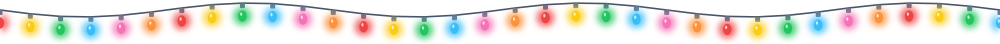
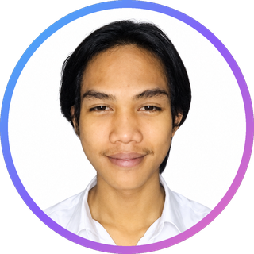

<div align="center">



</div>

<!-- ============================================================ -->
<!--                       HEADER BANNER                          -->
<!-- ============================================================ -->

<div align="center">


<br/>



<br/>

<a href="https://git.io/typing-svg">
  
</a>

<br/>


</div>

<br/>

<!-- ============================================================ -->
<!--                        QUICK CONTACT                         -->
<!-- ============================================================ -->

<div align="center">

### 📬 Let's Connect

<a href="https://wa.me/6283895288348?text=Halo%20Gilang%2C%20saya%20tertarik%20untuk%20berdiskusi%20dengan%20Anda">
  
</a>
<a href="mailto:ranggalinggani@gmail.com">
  
</a>
<a href="https://portfolio-gilangrangga.vercel.app/">
  
</a>

<br/>

<a href="https://github.com/GILANG-RANGGA-LINGGANI/GILANG-RANGGA-LINGGANI/raw/main/CV.pdf">
  
</a>
<a href="https://www.youtube.com/channel/UCgVxDgmsNZRZwDgS0KwFPdw">
  
</a>
<a href="https://www.tiktok.com/@gilangranggaid">
  
</a>

</div>

<br/>

<div align="center">


</div>

## 👨‍💻 About Me

```js
const gilang = {
  name: "Gilang Rangga Linggani",
  role: "Junior Web Developer",
  location: "Karawang, Indonesia 🇮🇩",
  currentFocus: ["React", "Tailwind CSS", "Modern JavaScript"],
  background: ["Mechanical Engineering (SMK Texmaco)", "Industrial Maintenance", "Web Development"],
  motto: "With great power comes great responsibility",
  mission: "Craft clean code, beautiful UI, and smooth user experience",
  openToWork: true,
};
```

I'm a **junior developer who is passionate about web development**. I love exploring new technologies and building creative projects. My journey started in the **mechanical engineering and industrial world**, where I learned discipline, precision, and problem solving, and now I bring that same mindset into code.

Guided by the principle **"With great power comes great responsibility"**, I design every line of code with full attention to:

- 🧱 **Structural neatness**: clean, readable, maintainable code
- 🎨 **Visual aesthetics**: modern, polished, good-looking interfaces
- 💡 **User comfort (UX)**: interfaces that feel natural and easy to use

<br/>

<div align="center">


</div>

## 🚀 What I'm Doing Right Now

| | |
|---|---|
| 🔭 **Currently learning** | React, Tailwind CSS, and the modern JavaScript ecosystem |
| 🛠️ **Currently building** | Creative web projects and my personal portfolio |
| 🌱 **Next on my list** | Deepening backend skills and full-stack development |
| 🎥 **Also creating** | Content on YouTube and TikTok |
| 💬 **Ask me about** | Frontend, web design basics, and switching careers into tech |
| ⚡ **Fun fact** | I went from fixing paper machines to building websites |

<br/>

<div align="center">


</div>

## 🧰 Tech Stack & Tools

### 🌐 Frontend

<p>
  
  
  
  
  
</p>

### ⚙️ Backend & Tools

<p>
  
  
  
  
  
</p>

### 📊 Productivity & Engineering

<p>
  
  
  
  
</p>

<br/>

<div align="center">


</div>

## 📈 Skill Overview

| Skill | Level |
|---|---|
| **HTML & CSS** |  |
| **JavaScript** |  |
| **React** |  |
| **Tailwind CSS** |  |
| **Backend** |  |
| **Microsoft Excel** |  |

<br/>

<div align="center">


</div>

## 💼 Experience

### 🖥️ Web Developer
**07/2026 – Present**

- Building modern, responsive websites using **React, Tailwind CSS, and JavaScript**
- Focused on clean structure, polished visual design, and great user experience
- Continuously learning and exploring new technologies in the web ecosystem

### 🏪 Crew Store Boy, PT Albany Corona Lestari (Indomaret Group)
**06/2024 – 05/2026** · Karawang, Indonesia

- Managed product display, stock replenishment, and price tag updates
- Delivered friendly customer service and assisted at the checkout during peak hours
- Helped maintain store equipment and supported inventory loss prevention
- Built strong teamwork, discipline, and communication skills in a fast-paced environment

### 🏭 Production Helper, PT Heinz ABC
**12/2022 – 11/2023** · Karawang, Indonesia

- Prepared and handled raw materials and supported packaging and production
- Performed preliminary quality checks and recorded stock data
- Maintained strict hygiene and followed OHS standards in a food industry setting

### 🔧 Asset Maintenance Management, PT Pindo Deli Pulp and Paper 2
**11/2020 – 01/2021** · Karawang, Indonesia

- Performed preventive and corrective maintenance on pulp and paper production machinery
- Troubleshot operational issues alongside mechanical, electrical, and instrumentation technicians
- Applied **5S** principles and OHS standards, contributing to the company's 5S Safety competitions

<br/>

<div align="center">


</div>

## 🎓 Education

**SMK Texmaco Karawang** · Teknik Mesin (Mechanical Engineering)
*05/2018 – 06/2021*

- Developed strong analytical skills and attention to detail
- Proficient with measuring instruments such as vernier calipers and micrometers
- Learned to create tool shapes using **AutoCAD**

<br/>

<div align="center">


</div>

## 📊 GitHub Stats

<div align="center">


<br/>


</div>

<br/>

## 🏆 Certifications & Documents

<div align="center">


<table>
<tr>
<td align="center" width="50%" valign="top">
<a href="assets/certificates/bnsp-competence.jpg"></a>
<br/><br/>
<b>Certificate of Competence (BNSP)</b><br/>
<sub>Badan Nasional Sertifikasi Profesi · LSP SMK Texmaco Semarang</sub><br/>
<sub>KKNI Level II · Machine Design &amp; Drawing Engineering · 24 May 2021</sub><br/><br/>
<a href="assets/certificates/bnsp-competence.jpg"></a>
</td>
<td align="center" width="50%" valign="top">
<a href="assets/certificates/japanese-n5.jpg"></a>
<br/><br/>
<b>Basic Japanese Language Education (N5)</b><br/>
<sub>UPTD Balai Latihan Kerja Disnakertrans Karawang &amp; LPK Galuh Berkarya</sub><br/>
<sub>Final score: 95</sub><br/><br/>
<a href="assets/certificates/japanese-n5.jpg"></a>
</td>
</tr>
<tr>
<td align="center" width="50%" valign="top">
<a href="assets/certificates/digital-literacy.jpg"></a>
<br/><br/>
<b>Essential Skills: Digital Literacy</b><br/>
<sub>GNIK × Kementerian Ketenagakerjaan RI · National Internship Program</sub><br/>
<sub>Score: 100 · 23 September 2026</sub><br/><br/>
<a href="assets/certificates/digital-literacy.jpg"></a> <a href="assets/certificates/digital-literacy.pdf"></a>
</td>
<td align="center" width="50%" valign="top">
<a href="assets/certificates/integrity-at-work.jpg"></a>
<br/><br/>
<b>Essential Skills: Integrity at Work</b><br/>
<sub>GNIK × Kementerian Ketenagakerjaan RI · National Internship Program</sub><br/>
<sub>Score: 94 · 23 September 2026</sub><br/><br/>
<a href="assets/certificates/integrity-at-work.jpg"></a> <a href="assets/certificates/integrity-at-work.pdf"></a>
</td>
</tr>
<tr>
<td align="center" width="50%" valign="top">
<a href="assets/certificates/work-reference.jpg"></a>
<br/><br/>
<b>Work Reference Letters (Surat Keterangan Kerja)</b><br/>
<sub>PT Albany Corona Lestari (Indomaret Group)</sub><br/>
<sub>Store Crew Boy · 29 Jun 2024 – 31 May 2026</sub><br/><br/>
<a href="assets/certificates/work-reference.jpg"></a>
</td>
<td align="center" width="50%" valign="middle">
<h3>🎯 More to come</h3>
<sub>I keep learning and collecting new certifications as I grow as a developer.</sub>
</td>
</tr>
</table>

</div>

<div align="center">


</div>

## 🎥 Follow My Content

<div align="center">

| Platform | What You'll Find | Link |
|:---:|:---|:---:|
| ▶️ **YouTube** | Videos, tutorials, and my journey. **Don't forget to subscribe!** | [](https://www.youtube.com/channel/UCgVxDgmsNZRZwDgS0KwFPdw) |
| 🎵 **TikTok** | Short clips and daily updates. **Don't forget to follow!** | [](https://www.tiktok.com/@gilangranggaid) |

### 🔔 Don't forget to **SUBSCRIBE** on YouTube and **FOLLOW** on TikTok, it really supports me a lot! 🙏

<a href="https://www.youtube.com/channel/UCgVxDgmsNZRZwDgS0KwFPdw">
  
</a>
<a href="https://www.tiktok.com/@gilangranggaid">
  
</a>

</div>

<br/>

<div align="center">


</div>

## 🤝 Open for Opportunities

I'm open to **junior web developer / frontend roles, freelance projects, internships, and collaborations**. If you have an idea, a project, or just want to chat about tech, feel free to reach out!

<div align="center">

<a href="https://wa.me/6283895288348?text=Halo%20Gilang%2C%20saya%20tertarik%20untuk%20berdiskusi%20dengan%20Anda">
  
</a>
<a href="mailto:ranggalinggani@gmail.com">
  
</a>
<a href="https://portfolio-gilangrangga.vercel.app/">
  
</a>
<a href="https://github.com/GILANG-RANGGA-LINGGANI/GILANG-RANGGA-LINGGANI/raw/main/CV.pdf">
  
</a>

</div>

<br/>

<div align="center">


</div>

<div align="center">

### 💬 *"With great power comes great responsibility."*

<br/>

**Thanks for stopping by! If you like my profile, leave a ⭐ and let's connect.**

<br/>


</div>


<div align="center">


</div>
